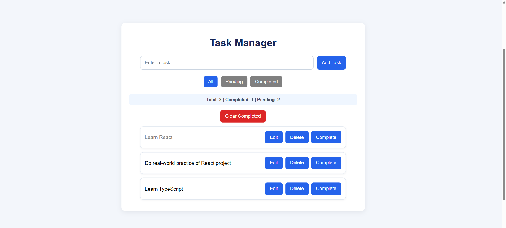
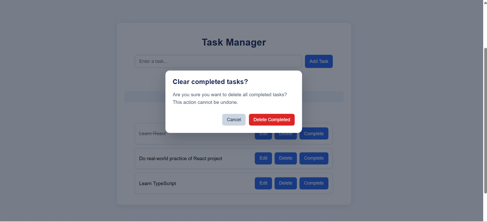
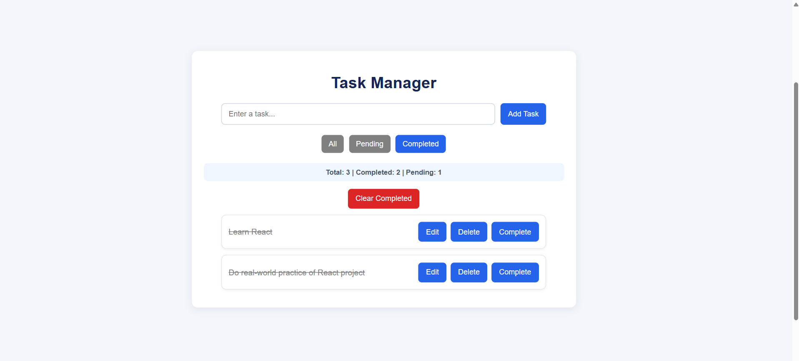

# Task Manager

A responsive task management web application built using HTML, CSS, and vanilla JavaScript. Create, edit, delete, filter, and track tasks with persistent browser storage.

**[Live Demo](https://riddhimistry141.github.io/task-manager/)** · **[View the source on GitHub](https://github.com/riddhimistry141/task-manager)**

## Features

- **Add Tasks:** Create tasks with input validation.
- **Edit Tasks:** Update task descriptions or cancel changes.
- **Delete Tasks:** Remove individual tasks.
- **Mark Complete:** Toggle tasks between completed and pending with a clearly labeled action.
- **Filter Tasks:** View all, pending, or completed tasks.
- **Task Counter:** Track total, completed, and pending tasks.
- **Clear Completed:** Remove all completed tasks with a custom confirmation popup.
- **Success Messages:** Receive feedback after clearing completed tasks.
- **Persistent Storage:** Save tasks in the browser using `localStorage`.
- **Responsive Design:** Adapt to desktop and mobile screens.
- **Keyboard Accessibility:** Visible focus indicators and keyboard-friendly popup controls.
- **Empty-State Feedback:** Display a message when no tasks exist.

## Screenshots

### Main Dashboard


### Custom Confirmation Popup


### Task Status and Filters


## Technologies Used

- HTML5
- CSS3
- JavaScript (Vanilla)
- Browser `localStorage` API

## Getting Started

1. Clone or download this repository.
2. Open the project folder.
3. Open `index.html` in your browser.
4. Start adding and managing tasks.

No package installation or backend server is required.

## Project Structure

```text
task-manager/
├── index.html
├── styles.css
├── script.js
├── README.md
└── screenshots/
    ├── task-manager-main.png
    ├── task-manager-confirmation.png
    └── task-manager-status.png
```

## Data Storage

Tasks are saved in the browser's `localStorage`. They remain available after refreshing the page in the same browser and origin. Clearing browser storage or using a different browser may remove or hide the saved tasks.

This project has no backend, account system, or cross-device synchronization.

## Testing

The implemented features have been manually tested, including task operations, filters, counters, persistence, responsive layout, keyboard navigation, and custom confirmation popup behavior.

## Future Improvements

- Task due dates and priorities
- Search tasks
- Dark mode
- Export and import tasks

## Author

**Riddhi Mistry**

A frontend portfolio project demonstrating DOM manipulation, event handling, array methods, form validation, responsive CSS, and browser storage.
